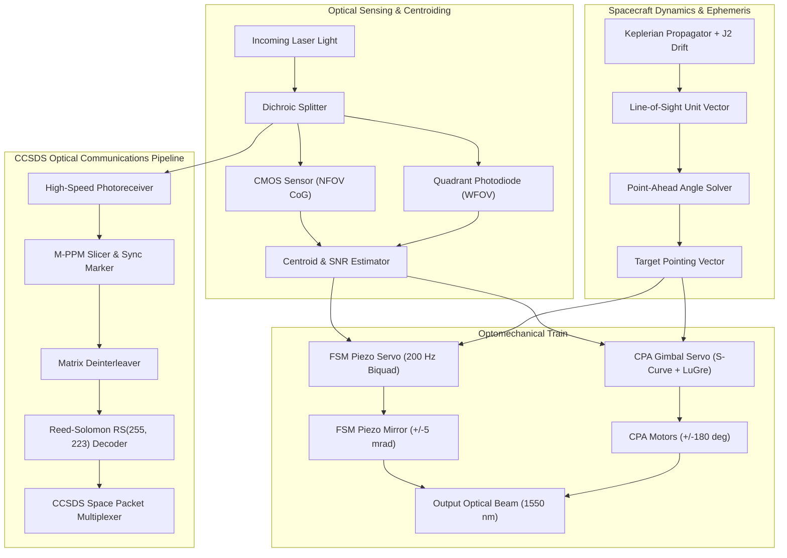

# Trunnion

[](https://github.com/aneesh495/trunnion/actions/workflows/ci.yml)
[](https://public.ccsds.org/)
[](https://forth-standard.org/)
[](LICENSE)
[-brightgreen.svg)](docs/verification.md)
[](tools/check_no_em_dash.py)

**Trunnion** is a production-grade, deterministically timed Satellite Laser Cross-Link Flight Software, Precision Pointing, Acquisition, and Tracking (PAT) Engine, and CCSDS Optical Communications Subsystem written in Forth.

Designed for Low Earth Orbit (LEO) mega-constellation inter-satellite links (ISL) and deep-space optical communication (DSOC) terminals, Trunnion coordinates a dual-stage optomechanical pointing assembly, evaluates high-precision Keplerian/J2 orbit geometry, compensates for relativistic point-ahead angles, and implements a CCSDS-compliant optical communications physical and data-link layer.

```
       Zenith (+Z)
             ^
             |       Elevation Axis (\theta)
             |          /
             |         /
             |     +--/---+
             |     |  O   |  Telescope Optical Aperture (1550 nm)
             |     +------+
             |        |
             |        +------- Azimuth Axis (\psi)
             |       /
             |      /
             +-----+----------------> Cross-Track (+Y)
            /
           /
          v
      Along-Track (+X)
```

---

## Technical Highlights

- **Pure 64-Bit Forth Flight Software**: Built without dynamic heap allocation or runtime garbage collection, providing sub-microsecond determinism across all control loops.
- **Hierarchical Dual-Stage Pointing Architecture**:
  - **Coarse Pointing Assembly (CPA)**: Hemispherical dual-axis gimbal ($\pm 180^\circ$ azimuth, $-20^\circ / +95^\circ$ elevation) with 7-segment S-curve jerk-limited trajectory generation and LuGre dynamic friction feedforward.
  - **Fine Steering Mirror (FSM)**: High-bandwidth piezoelectric tip-tilt mirror ($\pm 5\text{ mrad}$) running a 200 Hz biquad lead-lag digital filter to suppress spacecraft micro-vibrations and reaction wheel harmonics.
- **Relativistic Point-Ahead Vector Derivation**: Exact computation of transverse and radial velocity aberration vectors over inter-satellite distances up to 5,000 km:
  $$\mathbf{\theta}_{PA} \approx \frac{2}{c} (\mathbf{v}_{rel} - (\mathbf{v}_{rel} \cdot \mathbf{u}) \mathbf{u})$$
- **Multi-Sensor Optical Centroiding**:
  - Wide-Field-of-View Quadrant Photodiode (QPD) differential centroiding.
  - Narrow-Field-of-View (NFOV) sub-pixel Center-of-Gravity (CoG) estimator.
  - Conical nutation tracking with synchronous phase demodulation.
- **CCSDS 141.0-B-1 & 133.0-B-1 Optical Communications Subsystem**:
  - Photon-efficient $M$-ary Pulse Position Modulation (M-PPM with $M \in \{4, 8, 16, 32, 64\}$) with maximum-likelihood decision slicer.
  - 32-bit Attached Sync Marker (`0x1ACFFC1D`) correlator state machine.
  - Reed-Solomon $RS(255, 223)$ forward error correction codec over $GF(2^8)$ (corrects up to 16 byte errors per frame).
  - Matrix block interleaver ($I \in \{1, 2, 4, 8\}$) to mitigate deep optical fading bursts.
  - CCSDS Space Packet Protocol and AOS Transfer Frame multiplexing.
- **Deterministic 1 kHz Executive & Real-Time Kernel**:
  - Cooperative round-robin task scheduler with microsecond hardware timers, event flags, and message queues.
  - Execution headroom exceeding $99.9\%$ at 1 kHz (<0.8 microseconds per active control frame).
- **Dual Runtime Portability**: Runs natively on both Trunnion's zero-dependency ANSI C11 Virtual Machine (`bin/trunnion`) and standard GNU Forth (`gforth`).
- **Comprehensive Verification Suite**: 10 automated test suites verifying 128 top-level assertions across 338 individual checks with 100% pass rate.
- **Multi-Physics Hardware-in-the-Loop (HIL) Simulator**: Socket IPC simulation environment modeling Keplerian orbital dynamics, J2 oblateness secular drift, Gaussian beam propagation, and high-frequency reaction wheel jitter.

---

## System Architecture



---

## Mathematical Foundations & Theory of Operation

### 1. Keplerian Two-Body Orbit Propagation & J2 Secular Perturbations

Satellite cross-links require anticipating target position along orbit trajectories. Trunnion propagates orbit state vectors using Kepler's equation:

$$M(t) = M_0 + n (t - t_0)$$

$$E - e \sin(E) = M$$

Solved via high-precision Newton-Raphson iteration in Q32.32 fixed-point arithmetic (`forth/orbit/kepler.fs`).

To prevent long-term ephemeris drift, `forth/orbit/j2_perturbation.fs` evaluates the first-order secular drift induced by the Earth's oblateness parameter $J_2 = 1.08263 \times 10^{-3}$:

$$\dot{\Omega}_{J2} = -\frac{3}{2} n J_2 \left(\frac{R_E}{p}\right)^2 \cos(i)$$

$$\dot{\omega}_{J2} = \frac{3}{4} n J_2 \left(\frac{R_E}{p}\right)^2 (5 \cos^2(i) - 1)$$

where $p = a(1 - e^2)$ is the semi-latus rectum and $R_E = 6378.137\text{ km}$ is Earth's equatorial radius.

### 2. Relativistic Point-Ahead Angle (PAA) Exact Derivation

Because optical beams propagate at the speed of light $c$, a laser cross-link spanning distance $R = 5,000\text{ km}$ requires a transit time of $\Delta t = R / c \approx 16.68\text{ ms}$. Over this interval, an orbiting satellite traveling at $v \approx 7.5\text{ km/s}$ moves $\approx 125\text{ meters}$.

```
 Satellite A (Transmitter)                         Target Satellite B
      *                                                 * (At transmit time t_0)
       \                                               /
        \                                             /
         \                                           /  Satellite B motion:
          \  Transmit Line-of-Sight                 /   \Delta r = v_rel * \Delta t
           \                                       v
            \                                     * (At arrival time t_0 + R/c)
             \                                   /
              \   Point-Ahead Vector            /
               \===============================>
```

The required forward pointing offset $\mathbf{\theta}_{PA}$ relative to the apparent line-of-sight unit vector $\mathbf{u}$ is:

$$\mathbf{\theta}_{PA} = \frac{2}{c} \left[ \mathbf{v}_{rel} - (\mathbf{v}_{rel} \cdot \mathbf{u}) \mathbf{u} \right]$$

For typical low-Earth cross-links, $|\mathbf{\theta}_{PA}| \approx 50\text{ }\mu\text{rad}$. Because the 1550 nm telescope beam divergence is only $\approx 15\text{ }\mu\text{rad}$ full-width at half-maximum (FWHM), neglecting the point-ahead correction causes complete signal loss. Trunnion evaluates $\mathbf{\theta}_{PA}$ at 100 Hz in `forth/pat/point_ahead.fs`.

### 3. LuGre Dynamic Friction Model for Gimbal Bearing Actuation

Low-velocity tracking during orbital flybys is limited by non-linear bearing friction and stick-slip phenomena. Trunnion implements the LuGre dynamic friction model (`forth/kinematics/lugre_friction.fs`) to compute feedforward compensation torque:

$$\frac{dz}{dt} = v - \frac{\sigma_0 |v|}{g(v)} z$$

$$g(v) = F_c + (F_s - F_c) e^{-(v / v_s)^2}$$

$$T_f = \sigma_0 z + \sigma_1 \frac{dz}{dt} + \sigma_2 v$$

Injecting $T_f$ into the coarse gimbal motor drive eliminates limit cycles and deadzone hysteresis.

---

## Detailed Technical Documentation

Trunnion includes 8 comprehensive mathematical and system specifications in [`docs/`](docs/README.md):

1. **[Avionics & Software Architecture](docs/architecture.md)**: 64-bit Forth runtime, cooperative scheduler, 1 kHz executive cadence, and memory model.
2. **[Architecture Diagrams](docs/architecture_diagram.md)**: Optical bench relay layout, dual-stage control loop, PAT state machine, and CCSDS protocol stack.
3. **[PAT Theory & Derivations](docs/pat_theory.md)**: Spiral search equations, QPD/NFOV optical centroiding, relativistic point-ahead angle derivation.
4. **[Mechanism Dynamics & Servo Control](docs/cpa_fsm_dynamics.md)**: CPA kinematics, 7-segment S-curve profile, LuGre friction, and FSM biquad lead-lag filter.
5. **[CCSDS Optical Communications](docs/ccsds_optcomm.md)**: M-PPM modulation, 32-bit ASM correlator, Reed-Solomon RS(255, 223) codec, and matrix interleaver.
6. **[Memory Map & HAL Specification](docs/memory_map.md)**: Physical peripheral register offsets, binary housekeeping telemetry format.
7. **[Verification & Benchmark Plan](docs/verification.md)**: 10 test suite breakdowns, dual-target verification, and high-rate benchmark methodology.
8. **[Getting Started & Operator Manual](docs/getting_started.md)**: Toolchain requirements, REPL command dictionary, and HIL simulation guide.
