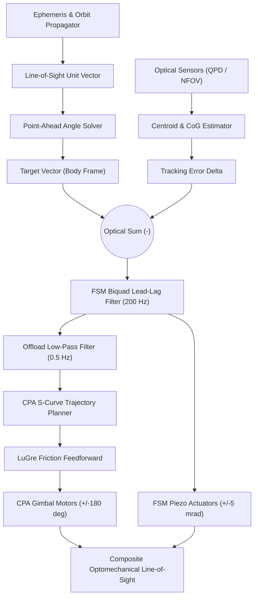
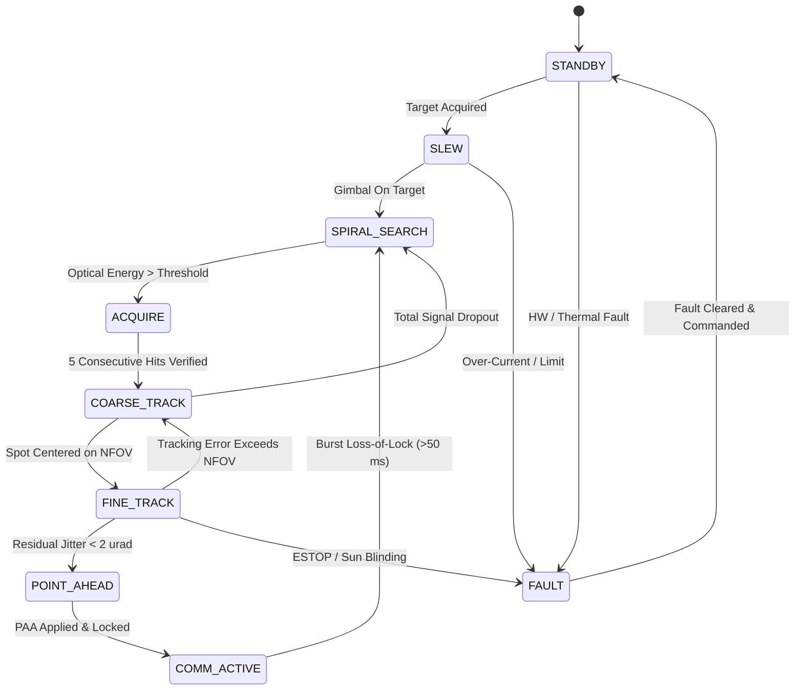

# System Architecture Diagrams

This document illustrates the hardware, software, control, and protocol architectures of the Trunnion Satellite Laser Cross-Link Flight Software subsystem.

---

## 1. Optical Bench & Relay Optomechanics

The optical payload integrates two steering stages, three optical sensor paths, a high-power communications transmitter, and a low-noise photoreceiver:

```
                            INCOMING OPTICAL BEAM
                                      |
                                      v
                        +---------------------------+
                        | Primary Telescope Mirror  |
                        | (Aperture: 100mm, f/10)   |
                        +---------------------------+
                                      |
                                      v
                        +---------------------------+
                        |  Coarse Pointing Assembly |  (Azimuth / Elevation)
                        |  (Two-Axis Gimbal Base)   |  (Range: +/-180 deg, -20/+95 deg)
                        +---------------------------+
                                      |
                                      v
                        +---------------------------+
                        | Fine Steering Mirror      |  (Piezo Tip / Tilt)
                        | (Silicon Carbide Mirror)  |  (Range: +/-5 mrad, 200 Hz BW)
                        +---------------------------+
                                      |
                                      v
                        +---------------------------+
                        |   Dichroic Beam Splitter  |
                        +---------------------------+
                               /             \
                              /               \ (1550 nm Comm)
           (Acquisition Path)/                 \
                            v                   v
            +-----------------------+     +-----------------------+
            | Fold Mirror / Splitter|     | High-Speed Photodiode |
            +-----------------------+     | (APD / SNSPD Direct)  |
               /                 \        +-----------------------+
              /                   \                   |
             v                     v                  v
    +-----------------+   +-----------------+   +-----------------+
    | Wide FOV QPD    |   | Narrow FOV CMOS |   | M-PPM Demod     |
    | (Quadrant Diode)|   | (Sub-Pixel CoG) |   | Frame Correlator|
    +-----------------+   +-----------------+   +-----------------+
             |                     |                  |
             +----------+----------+                  |
                        |                             |
                        v                             v
             [Optical Error Tracking]      [Decoded CCSDS Data]
```

### Optical Transmission Relay (Transmit Path)

```
[CCSDS Space Packets] ---> [RS(255,223) + Interleaver] ---> [M-PPM Modulator]
                                                                   |
                                                                   v
                                                        [1550 nm Seed Laser]
                                                                   |
                                                                   v
                                                        [EDFA Power Booster]
                                                                   |
                                                                   v
                                                        [Point-Ahead Mirror]
                                                                   |
                                                                   v
                                                        [Transmit Collimator]
                                                                   |
                                                                   v
                                                        [Exit Aperture to Space]
```

---

## 2. Hierarchical Dual-Stage Control Loop Architecture

To achieve sub-microradian optical pointing while rejecting satellite body vibrations, Trunnion distributes control commands across the slow, wide-angle Coarse Pointing Assembly (CPA) and the fast, narrow-angle Fine Steering Mirror (FSM):



---

## 3. Master PAT State Machine

The Pointing, Acquisition, and Tracking (PAT) engine sequences autonomous optical link establishment through eight discrete states:



---

## 4. CCSDS Optical Communications Protocol Stack

The flight software implements the layered protocol architecture compliant with CCSDS recommendations:

```
+-------------------------------------------------------------------------+
| APPLICATION LAYER                                                       |
| Spacecraft Telemetry Packets, Science Data, Ground Command Payloads    |
+-------------------------------------------------------------------------+
                                    |
                                    v
+-------------------------------------------------------------------------+
| CCSDS SPACE PACKET PROTOCOL (CCSDS 133.0-B-1)                           |
| Version (3b), APID (11b), Sequence Counter (14b), Packet Length (16b)  |
+-------------------------------------------------------------------------+
                                    |
                                    v
+-------------------------------------------------------------------------+
| AOS TRANSFER FRAMES (CCSDS 732.0-B-3)                                   |
| Transfer Frame Version Number, Spacecraft ID, Virtual Channel ID (VCID) |
+-------------------------------------------------------------------------+
                                    |
                                    v
+-------------------------------------------------------------------------+
| FORWARD ERROR CORRECTION & CODING                                       |
| Reed-Solomon RS(255, 223) Codec (GF(2^8), Corrects 16 Symbol Errors)    |
| Matrix Block Interleaver (Depth I = 1, 2, 4, 8)                         |
+-------------------------------------------------------------------------+
                                    |
                                    v
+-------------------------------------------------------------------------+
| SYNCHRONIZATION SUBLAYER                                                |
| 32-Bit Attached Sync Marker (ASM = 0x1ACFFC1D)                          |
+-------------------------------------------------------------------------+
                                    |
                                    v
+-------------------------------------------------------------------------+
| OPTICAL PHYSICAL LAYER (CCSDS 141.0-B-1)                                |
| M-ary Pulse Position Modulation (M = 4, 8, 16, 32, 64)                  |
| 1550 nm High-Purity Narrow-Linewidth Laser                              |
+-------------------------------------------------------------------------+
```

---

## 5. Real-Time Scheduler Cadence & Frame Timeline

The hard real-time executive runs at a strict $1\text{ kHz}$ periodic cadence ($1.0\text{ ms}$ frame budget), orchestrated by the hardware timer interrupt:

```
Time (ms): 0.0          0.2          0.4          0.6          0.8          1.0
           +------------+------------+------------+------------+------------+
Hardware:  | Latch MMIO |                                                   |
           +------------+                                                   |
Sensors:   | QPD & NFOV Readout      |                                      |
           +------------+------------+                                      |
Control:                | FSM Lead-Lag Step       |                         |
                        +------------+------------+                         |
Kinematics:                          | CPA S-Curve & LuGre |                |
                                     +------------+--------+                |
Watchdog:                                         | Kick   |                |
                                                  +--------+                |
Headroom:                                                  | IDLE (>99.9%)  |
                                                           +----------------+
           |<----------------- Active: ~0.8 us ----------->|
           |<---------------- Total Budget: 1000.0 us --------------------->|
```

### Background Task Allocations

Outside the hard real-time $1\text{ kHz}$ interrupt context, cooperative tasks execute on designated cycle divisors:

- **100 Hz (Divisor 10)**: Offload filter computation and telemetry FIFO streaming.
- **10 Hz (Divisor 100)**: Binary housekeeping packet serialization and CRC calculation.
- **1 Hz (Divisor 1000)**: Optical bench and laser diode thermal PID heater regulation.
- **Background / Idle**: Operator REPL console, engineering memory dumps, and command parser.
